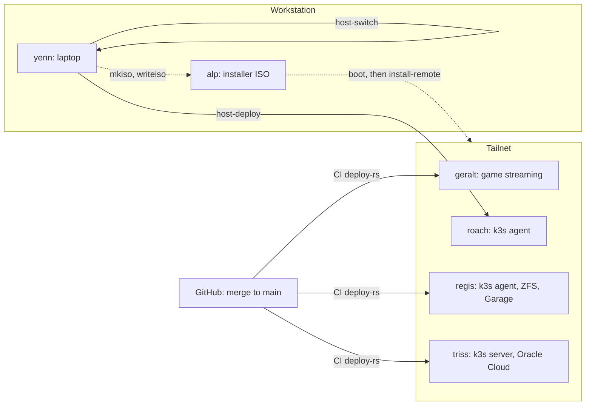
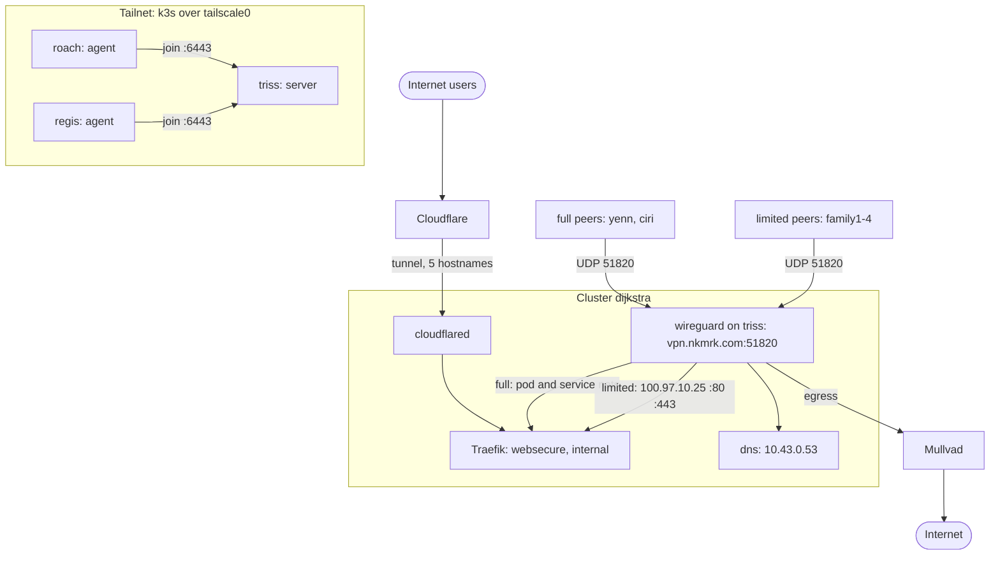
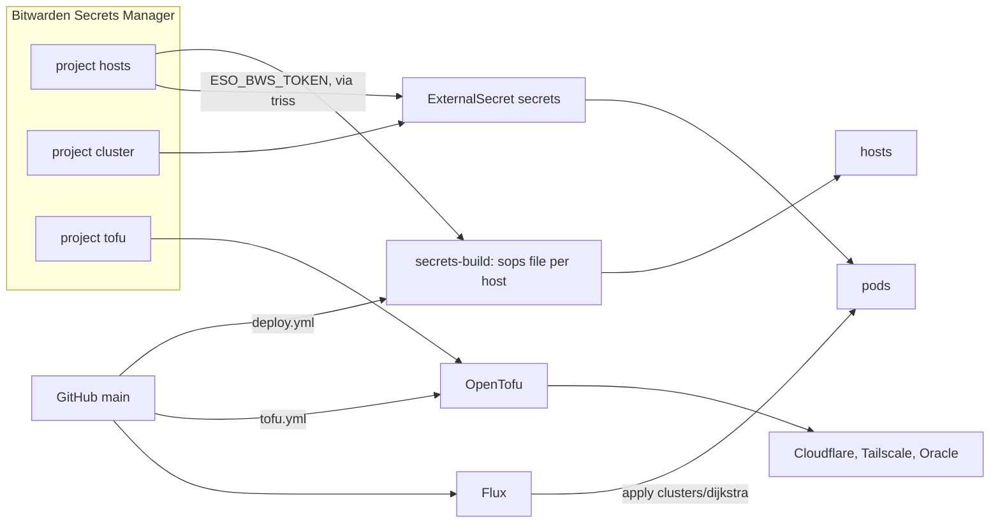
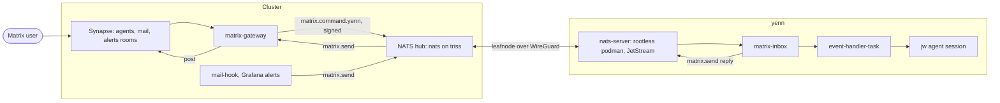
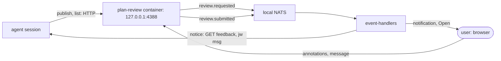
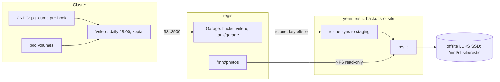

# infra

Nix flake monorepo: NixOS hosts (impermanent root), their packages and the k3s cluster `dijkstra`. Agent rules: `AGENTS.md`. Run commands from the repo root in the dev shell.

## Overview

### Hosts and deploy



### Network



### Secrets and GitOps



## Layout

```
flake.nix              inputs, nixosConfigurations, deploy-rs nodes, packages
devenv.nix             dev shell: tools and scripts
secretspec.toml        inventory of secrets: a profile per host, plus dijkstra, tailscale, ci, tofu
.sops.yaml             age recipients, one per host
host/<name>/           per-host config, hardware, ssh_host_ed25519_key.pub
host/features/         default.nix, global/ (always on), optional/ (k3s, tailscale, docker, wolf, ...), disko/
modules/host/          own NixOS modules: persist, secrets, eso-bws-token, agents, battery-notifier
pkgs/                  wrapped packages and own tools
clusters/dijkstra/     Kubernetes manifests, reconciled by Flux
tofu/                  OpenTofu: Cloudflare, Tailscale, Oracle Cloud
.github/               CI (hosts, deploy, tofu, cluster, images, lint); renovate.json: weekly update PRs
```

## Hosts

| Host | Arch | Role | Deploy |
|------|------|------|--------|
| `yenn` | x86_64 | laptop (Hyprland), LUKS + btrfs | `host-switch` (not a deploy node) |
| `geralt` | x86_64 | headless game streaming (Wolf + Moonlight), docker, libvirt; usually off | CI |
| `roach` | x86_64 | k3s agent | `host-deploy` |
| `regis` | x86_64 | k3s agent, encrypted ZFS (`rpool`, data pool `tank`), NFS server, Garage (S3: Velero, nix cache) | CI |
| `triss` | aarch64 | k3s server, Oracle Cloud instance (qemu guest) | CI |
| `alp` | x86_64 | installer ISO (`mkiso`), not in `nixosConfigurations` | none |

Deploy nodes: ssh as `maintenance` (passwordless sudo only for deploy-rs). `triss` break-glass: `ssh maintenance@141.147.2.187`, then `sudo kubectl`.

### geralt

- Wolf: `host/features/optional/wolf.nix`, state `/etc/wolf`, pairing URL in `docker logs -f wolf`.
- Wake with `wake-geralt` on `yenn`; reboot once after `.link` changes.
- Suspends after 30 min idle (`host/geralt/idle-suspend.nix`). Pause: `sudo systemd-run --unit=stay-awake systemd-inhibit --what=sleep sleep 4h`; cancel: `sudo systemctl stop stay-awake`.

| Component | Details |
|-----------|---------|
| CPU | AMD Ryzen 9 3900X (12C/24T), stock AMD Wraith Prism RGB cooler |
| Motherboard | Gigabyte B450M DS3H (AM4), BIOS F41 |
| RAM | 32 GB, 2x Kingston FURY Beast 16 GB DDR4-3600 CL18 (KF3600C18D4/16GX) in DIMM 1 of channels A and B; 2 of 4 slots used, max 128 GB |
| GPU | Gigabyte Radeon RX 5500 XT OC 4G (GV-R55XTOC-4GD, Navi 14) |
| SSD | Crucial P1 1 TB NVMe (CT1000P1SSD8) |
| Ethernet | onboard Realtek RTL8111/8168 1 GbE, Wake-on-LAN, MAC `b4:2e:99:a4:86:1c` |
| WiFi | TP-Link Archer T2U Nano USB (RTL8811AU, driver `rtw88_8821au`) |
| PSU | 750 W, Corsair RM750x (model unverified) |

### yenn

| Component | Details |
|-----------|---------|
| Model | Framework Laptop 13 (AMD Ryzen AI 300 Series), board FRANMGCP05, BIOS 03.05 (2025-10-30) |
| CPU | AMD Ryzen AI 5 340 (6C/12T), iGPU Radeon 840M |
| RAM | 16 GB, 1x ADATA 16 GB DDR5-5600 SODIMM (AD5S560016G-SFW) in channel B; 1 of 2 slots used, max 64 GB |
| SSD | WD_BLACK SN7100 1 TB NVMe |
| Display | 13.5" 2256x1504 |
| WiFi/Bluetooth | MediaTek MT7925 (`mt7925e`) |
| Battery | 61 Wh (FRANGWA) |
| Other | Goodix fingerprint reader, Framework webcam module (2nd gen), HDMI expansion card |

### regis

| Component | Details |
|-----------|---------|
| Model | TerraMaster F4-425 Pro (board M-TWLN01), BIOS BJFX-TWLX-108 (2026-02-02) |
| CPU | Intel Core i3-N305 (8C/8T), iGPU Intel UHD (`i915`) |
| RAM | 8 GB, 1x Shenzhen Zhongteng 8 GB DDR4-3200 SODIMM (no part number) in Controller0-ChannelA-DIMM0; 1 of 2 slots used, max 64 GB |
| SSD | Samsung 990 PRO 1 TB NVMe (`rpool`) |
| HDD | 2x Seagate IronWolf Pro 18 TB (ST18000NE000), ZFS mirror (`tank`); 2 of 4 bays used |
| Ethernet | 2x onboard Realtek RTL8126 5 GbE (out-of-tree `r8126`), MACs `6c:bf:b5:05:77:88`, `6c:bf:b5:05:77:89` |

#### Garage

Buckets: `buckets` in `host/regis/garage.nix`. Keys: lines `<name> <id> <secret>` of `regis/GARAGE_KEYS` (project `hosts`). `garage-provision` applies both on deploy (`journalctl -u garage-provision`; retry `sudo systemctl restart garage-provision`).

| Operation | Steps |
|-----------|-------|
| Add bucket or key | add a `GARAGE_KEYS` line (id `printf 'GK%s\n' "$(openssl rand -hex 12)"`, secret `openssl rand -hex 32`), add bucket or grant to `buckets`, deploy `regis` |
| Remove key | drop it from `buckets`, deploy (key deleted, id can't be re-imported), remove its line |
| Rotate key | add a line under a new name, point the bucket at it, deploy, switch the consumer, drop the old name, deploy, remove the old line |
| Remove bucket | drop it from `buckets`, deploy, empty it, `garage bucket delete --yes <bucket>` |

- Key copies: Velero in `cluster` items `velero/access_key_id`, `velero/secret_access_key`; CI in GitHub environment `nix-cache`.

## Dev shell

Secret scripts need `BWS_ACCESS_TOKEN` (machine account `ci-hosts`, or a local token).

| Script | What it does |
|--------|--------------|
| `host-switch [action]` | `nixos-rebuild <action>` (default `switch`) of this host |
| `host-deploy <node...>` | deploy-rs to the nodes |
| `install-remote <host> <user@ip>` | first install with nixos-anywhere + disko |
| `secrets-build <outdir> <host...>` | build sops files from the project `hosts` |
| `mkiso` / `writeiso /dev/XXX` | build the `alp` ISO / write it |
| `tofu <args>` | OpenTofu in `tofu/`; `fmt`, `version`, `validate`, `init -backend=false` need no token |

## Installing a new host

1. Add `host/<name>/default.nix`, a `nixosConfigurations` entry (and `deploy.nodes`) and a disko layout (`host/features/disko/`, `host/regis/storage.nix`).
2. Generate the host key (also its sops identity):
   ```sh
   ssh-keygen -t ed25519 -N "" -f host/<name>/ssh_host_ed25519_key
   ssh-to-age < host/<name>/ssh_host_ed25519_key.pub
   ```
   Commit only `.pub`; store the private half as `<name>/HOST_SSH_ED25519_PRIV` in project `hosts`, delete the local file.
3. Add the age key to `.sops.yaml` (anchor under `&hosts`, rule `host/<name>/.+$`) and `[profiles.<name>]` to `secretspec.toml`; create `<name>/<KEY>` items.
4. Boot the ISO (`host/alp/key` is a git-ignored Tailscale auth key).
5. ZFS host: create `host/<name>/disk.key` (git-ignored; `regis`: `dd if=/dev/urandom of=host/regis/disk.key bs=32 count=1`).
6. `install-remote <name> root@<ip>`.
7. Servers join as `tag:server` with `tailscale/TAILSCALE_AUTH_KEY`. K3s node: install without `k3s.nix`, add `tailscale ip -4` to `ips` in `host/features/optional/k3s.nix`, `host-deploy`.

## Updating hosts

```sh
host-switch            # the machine you are on (yenn)
host-switch test       # any nixos-rebuild action
host-deploy geralt roach
```

- CI deploys `geralt`, `regis`, `triss` on merge (`deploy.yml`) and builds every host on PRs (`hosts.yml`); re-running an old run redeploys that commit.
- Deploy reads profile `ci` from project `hosts`; GitHub environment `deploy` holds `BWS_ACCESS_TOKEN` of `ci-hosts`.

## Secrets

- `config.secrets.<name>` (`modules/host/secrets.nix`): read only `.path`; `profile` picks another profile (e.g. `dijkstra`).
- `host/features/global/sops.nix` reads `<host>.yaml` from the `secrets` input (`path:./secrets-stub`).
- `secretspec.toml`: uppercased names per profile; evaluation fails on a mismatch.
- Items: `<profile>/<KEY>` in project `hosts`; project `tofu` has plain names.
- `secrets-build <outdir> <host...>` writes `<outdir>/<host>.yaml`; scripts pass `--override-input secrets path:<outdir>`. By hand:
  ```sh
  secrets-build /tmp/s geralt
  nixos-rebuild build --flake .#geralt --override-input secrets path:/tmp/s
  ```

### Adding a secret

1. Declare it and read its path (`neededForUsers = true` if read at user creation):
   ```nix
   secrets.myservice_token = { owner = "myservice"; mode = "0400"; };
   services.myservice.tokenFile = config.secrets.myservice_token.path;
   ```
2. Add `MYSERVICE_TOKEN = { description = "...", required = true }` to `[profiles.<host>]` in `secretspec.toml`.
3. Create `<host>/MYSERVICE_TOKEN` in project `hosts`.
4. Dry-run build (`<dir>` holds an empty `<host>.yaml`), then `host-deploy geralt`:
   ```sh
   mkdir -p /tmp/s && touch /tmp/s/geralt.yaml
   nix build --dry-run .#nixosConfigurations.geralt.config.system.build.toplevel --override-input secrets path:/tmp/s
   ```

## Persistence

Root is rolled back every boot (`modules/host/persist.nix`); only `/persist` survives.

| Option | Meaning |
|--------|---------|
| `persist.enable` | rollback and bind mounts on |
| `persist.deviceService`, `persist.rootPath` | device unit (e.g. `dev-nvme0n1p2.device`); root device |
| `persist.isCrypted` / `persist.isZfs` | wait for `cryptsetup.target` / ZFS rollback |
| `persist.data.{directories,files}` | kept state, `/persist/data` |
| `persist.generated.{directories,files}` | regenerable state, `/persist/generated` |
| `persist.users.<user>.{data,generated}` | same, relative to the home |

Rollback: btrfs keeps old roots in `old_roots/<timestamp>` 30 days; ZFS `zfs rollback -r rpool/root@blank` (`host/regis/storage.nix`).

## Packages

- Add: `pkgs/<name>/default.nix`, register in `pkgs/default.nix` (`<name> = pkgs.callPackage ./<name> {<name> = prev.<name>;};`); build `nix build .#<name>` (handlers: `.#event-handlers.<name>`).
- `dataDir` for `bitwarden-cli`, `gh`, `glab`, `heroic`, `moonlight-qt`, `obsidian`, `prismlauncher`, `zen-browser`: `.override {dataDir = "/persist/generated/home/<user>/<app>";}`.
- `claude`: `.extend {...}`, see `pkgs/claude/README.md`.

### Tools

| Package | What it is |
|---------|------------|
| `jj-upload`, `forge` | stacked MRs from jj; GitLab/GitHub client |
| `jw` | agent workspaces and sessions (`jw --help`) |
| `event-bus` | `event-pub TYPE`, `event-subscribe HANDLER SUBJECT...` over NATS |
| `event-handlers` | user service running `pkgs/event-handlers/handlers` |
| `agent-task`, `claude-hooks`, `claude-statusline`, `agent-skills` | task capture, Claude hooks, status line, skills |
| `plan-review` | HTML plan reviews in the browser |
| `matrix-gateway`, `matrix-inbox` | Matrix bridge of the hub; signed `!host` commands on `yenn` |

### Agents and events



- Leaf link (`pkgs/nats-server/nats.conf`) denies `events.>`, `$SYS.>`, `$JS.>`, `$KV.>`, `$O.>`, `_INBOX.>`: events stay on `yenn`.
- `matrix-inbox` is a second `event-handlers` instance (`matrix.command.yenn`), verifies `pkgs/matrix-inbox/gateway.pub`.

| Subject | Handler | Does |
|---------|---------|------|
| `events.task.new` | `task` | `jw agent -d`, then `task.started` or `task.failed` |
| `events.task.failed` | `notify-normal` | desktop notification |
| `events.backup.>` | `notify-critical` | critical notification |
| `events.claude.waiting`, `events.session.result` | `report` | message to the supervisor session |
| `events.forge.>` | `forge` | message to the MR's session |
| `events.review.requested` | `review-intake` | notification that opens the review |
| `events.review.submitted` | `review` | feedback message to the session |

### Plan reviews



- `plan-review publish <file> "<title>"` (session `$AGENT_SESSION`); `plan-review list` shows reviews.
- Server: `podman-plan-review.service`, `127.0.0.1:4388`, volume `plan-review`; API `POST /api/publish`, `GET /api/reviews`, `GET /api/feedback/<review>/<revision>`. It must run, else `cannot reach the plan-review server`.
- Full feedback: `curl -s http://127.0.0.1:4388/api/feedback/<review>/<revision> | jq -r .text`.

## External infrastructure

OpenTofu in `tofu/`; state in bucket `tofu-state` on Oracle Cloud (no locking), secrets from project `tofu`.

- Managed: Cloudflare zone `nkmrk.com` (`tofu/cloudflare.tf`, mail in `tofu/mail.tf`), tailnet policy and DNS, Oracle `triss` with its network, the state bucket, the budget.
- Manual: API tokens, Tailscale OAuth clients, cloudflared tunnel, Mullvad, Matrix users, GitHub.
- Merge to `main` plans and applies (environment `tofu`); a plan with deletes or replaces fails: apply it locally.
- Stop managing: `removed { from = ... lifecycle { destroy = false } }`.
- Drift: `tofu plan -detailed-exitcode`; lock upgrade: `tofu init -upgrade -backend=false`.
- Import: `tofu/imports-<provider>.tf`, `tofu plan -generate-config-out=generated.tf`, move into `tofu/<provider>.tf`, apply, delete the imports file.
- Tailscale policy: only `tofu/tailscale-policy.json`; lock-out break-glass: console JSON editor.
- Oracle: `oci.tf` holds all rules; keep TCP 22, UDP 51820, default route.

## Cluster

- k3s over tailscale: `triss` server, `roach`/`regis` agents; `host/features/optional/k3s.nix`, token `dijkstra/K3S_TOKEN` (project `hosts`).
- Flux applies `main` to `./clusters/dijkstra`; variable `DOMAIN`; resources with shell `$` need `kustomize.toolkit.fluxcd.io/substitute: disabled`.

### Cluster apps

| App | What it is | Notes |
|-----|------------|-------|
| `arrstack` | sonarr, radarr, lidarr, prowlarr, bazarr, qbittorrent (gluetun/Mullvad), beets, flaresolverr | KEDA-scaled |
| `cloudflare` | cloudflared tunnel | public hostnames in `cloudflared.yaml` |
| `cnpg` | CloudNativePG operator | see Break-glass |
| `dns` | split DNS for `nkmrk.com` at `10.43.0.53` | |
| `immich`, `navidrome` | photos; Navidrome + `audiomuse-ai` | DBs `immich-postgres`, `audiomuse-postgres` |
| `mail-hook` | mail to `t.nkmrk.com` as posts in `#mail` | `tofu/mail-worker.js` |
| `matrix` | Synapse, mautrix `whatsapp`/`meta`, `gateway` | DB `matrix-postgres` |
| `monitoring` | VictoriaMetrics, kube-state-metrics, Loki, Grafana | |
| `nats` | hub on `triss`, no JetStream | new client namespace: add to NetworkPolicy |
| `omniverse` | git-sync, WebDAV, radicale | |
| `wireguard` | VPN on `triss`, Mullvad egress | |

Others: `cert-manager`, `cron`, `external-secrets`, `intel-gpu-plugin`, `jellyfin` (with seerr), `keda`, `ollama`, `openebs`, `proxy` (traefik, gateway), `velero`, `webdav`.

Internal service (`<name>.nkmrk.com`, listener `internal`): HTTPRoute with `sectionName: internal` plus an entry in the `dns` Corefile; via KEDA (`bazarr`, `prowlarr`) also its `HTTPScaledObject` host.

#### App notes

- wireguard: Mullvad items `wireguard/mullvad_*`; peers `10.13.13.2-127` limited, `10.13.13.128-254` full; new peer: next free `10.13.13.N/32` in `wg0.conf`, client `DNS = 10.43.0.53`, `MTU = 1200`, `Endpoint = vpn.nkmrk.com:51820`; `yenn` is a peer: `sudo networkctl down wg0` / `up`.
- matrix: new user: `kubectl -n matrix exec -it deploy/synapse -- register_new_matrix_user -c /config/homeserver.yaml http://localhost:8008` (`matrix/registration_shared_secret`); bot `@agents`, rooms `#agents`, `#mail`, `#alerts`; never type secrets in `#agents`.
- mail-hook: `mail-hook/mail_hook_token` (`cluster`) must equal `TF_VAR_mail_hook_token` (`tofu`).
- omniverse: `omniverse/calendar_subscriptions`; refresh: `kubectl -n omniverse create job --from=cronjob/calendar-subscriptions refresh-now`.
- monitoring: write `http://100.97.10.25:8428/api/v1/write`, Loki push `http://100.97.10.25:3100/loki/api/v1/push`; scrape pods with `prometheus.io/scrape: "true"` (`prometheus.io/port`, `prometheus.io/path`); targets: `kubectl -n monitoring port-forward svc/victoria-metrics-single-server 8428`, `/targets`; Alloy on every host (`host/features/global/monitoring.nix`); Grafana `grafana.${DOMAIN}`, user `admin`, `monitoring/grafana_admin_password`, dashboards in `monitoring/grafana/dashboards`; PVCs `victoria-metrics`, Loki `backup: skip`.

### Kubernetes secrets

ExternalSecret `clusters/dijkstra/<ns>/external-secret.yaml` builds Secret `secrets` from project `cluster` (ClusterSecretStore `bitwarden`, account `eso`); items `<ns>/<key>`, lowercase. Token: `dijkstra/ESO_BWS_TOKEN` (project `hosts`), applied by `triss` (`services.eso-bws-token`).

1. Create item `<ns>/<key>` in project `cluster`.
2. Add `- secretKey: <key>` with `remoteRef: {key: <ns>/<key>}` to the ExternalSecret `data`.
3. Reference secret `secrets`, key `<key>`.

Sync now (then delete the pod if it reads the secret at startup):

```sh
kubectl -n <ns> annotate externalsecret secrets force-sync=$(date +%s) --overwrite
```

- Rotated ESO token: deploy `triss`, restart `eso-bws-token.service`.
- Fresh cluster: k3s and `triss`, `flux bootstrap`, `kubectl apply -f` `clusters/dijkstra/cert-manager/` and `clusters/dijkstra/external-secrets/{namespace,helm,sdk-server}.yaml`, wait for Ready, reconcile.

### Nix cache

- Bucket `nix-cache` on `regis`: `http://nix-cache:3902` (workflows map it to `100.100.215.91`), key `nix-cache-1`; trust in `host/features/global/nix.nix` (not `triss`), `hosts.yml`, `deploy.yml`.
- `hosts.yml` uploads on push to `main` (S3 port 3900); environment `nix-cache` holds `NIX_CACHE_SIGNING_KEY`, `NIX_CACHE_ACCESS_KEY_ID`, `NIX_CACHE_SECRET_ACCESS_KEY`; repo secrets `TS_CACHE_OAUTH_CLIENT_ID`, `TS_CACHE_OAUTH_SECRET` (`tag:ci-cache`).
- Signing key leak: `nix-cache-2` in all three places plus the secret and Bitwarden, empty the bucket, redeploy all (`host-switch` on `yenn`, `host-deploy roach`).
- Quota 200 GiB. Wipe (`garage` on `regis`, `aws` on the tailnet with the printed id and secret):
  ```sh
  garage key create wipe
  garage bucket allow --read --write nix-cache --key wipe
  export AWS_ACCESS_KEY_ID=<GK...> AWS_SECRET_ACCESS_KEY=<secret>
  nix run nixpkgs#awscli2 -- s3 rm --recursive s3://nix-cache --endpoint-url http://100.100.215.91:3900 --region garage
  garage key delete --yes wipe
  ```

### Backups



- Velero schedule `daily-openebs`: 18:00 Europe/Warsaw, 30 days, bucket `velero` at `http://100.100.215.91:3900` (`tailscale0`, `cni0` only); key = line `velero` of `regis/GARAGE_KEYS`, copied to `velero/access_key_id`, `velero/secret_access_key` (project `cluster`).
- Not backed up: `kube-system`, `velero`, `flux-system`, Secrets, `local-storage`, emptyDir, PVCs `backup: skip` (`velero/volume-policy.yaml`).
- Beets `library.db` is on PVC `beets-data`: delete a stale `library.db-journal` before restoring it.
- Alerts to `#alerts`: BackupStale, BackupFailed.
- Off-pool SSD (partition `offsite`, LUKS2, btrfs) on `yenn`: `restic-backups-offsite` (`host/yenn/offsite-backup.nix`), hourly, at most every 20 h, not 17:00-20:00; keeps 7 daily, 4 weekly, 6 monthly; checks 5%.
- It aborts if the repo (`restic init` once), bucket `velero` or photos are missing or empty.
- LUKS key = restic password = `yenn/OFFSITE_KEY` (project `hosts`); `yenn/OFFSITE_S3_ENV` = read-only Garage key `offsite`.
- Status: `journalctl -u restic-backups-offsite`, `sudo restic-offsite snapshots`; notice after 7 days without a run.

#### Restore

```sh
flux suspend kustomization flux-system -n flux-system
kubectl -n <namespace> delete deploy --all
kubectl -n <namespace> get pvc -L backup
kubectl -n <namespace> delete pvc <the openebs-* PVCs without backup=skip>
velero restore create --from-backup <backup> --include-namespaces <namespace> --wait
velero restore describe <restore> --details
flux resume kustomization flux-system -n flux-system
```

- Delete only backed-up `openebs-*` PVCs; keep `backup: skip` and `local-storage` ones.
- Shared PVCs (`arrstack-config-pvc`, `omniverse-pvc`): restore with kopia.
- Never delete the namespace: media PVs go Released.
- Arrstack: first `kubectl -n arrstack delete httpscaledobject --all`.
- Afterwards `kubectl delete pv <pv>`, then `kubectl -n openebs delete zfsvolume <pv>` or remove `/var/openebs/local/<pv>` on `triss`.

##### Restore a volume with kopia

1. Suspend Flux, scale the app to 0 (delete its HTTPScaledObject if KEDA scales it):
   ```sh
   flux suspend kustomization flux-system -n flux-system
   kubectl -n <namespace> scale deploy/<app> --replicas=0
   ```
2. On the volume's node, connect read-only (password from `velero/velero-repo-credentials`):
   ```sh
   sudo nix run nixpkgs#kopia -- repository connect s3 --endpoint 100.100.215.91:3900 --disable-tls --bucket velero --prefix kopia/<namespace>/ --region garage --access-key <GK...> --secret-access-key <secret> --password static-passw0rd --readonly
   ```
3. Find the snapshot ID (offline: `kopia snapshot list --all`):
   ```sh
   kubectl -n velero get podvolumebackups -l velero.io/backup-name=<backup> -o custom-columns=VOL:.spec.volume,POD:.spec.pod.name,SNAP:.status.snapshotID
   ```
4. Pick `<path>` and `<aside>` (`<pv>` = PVC `spec.volumeName`):
   - `triss`: `<path>` `/var/openebs/local/<pv>`, `<aside>` `/var/openebs/local/<pv>.pre-restore`.
   - `regis`: `<path>` `/mnt/restore`, `<aside>` `/mnt/openebs/pre-restore-<pv>`; mount the dataset:
     ```sh
     sudo mkdir -p /mnt/restore && sudo mount -t zfs rpool/openebs/<pv> /mnt/restore
     ```
5. Restore into an empty directory (SQLite `-wal`/`-shm` corrupt otherwise); on `regis` then `sudo umount /mnt/restore`:
   ```sh
   sudo mkdir <aside>
   sudo find <path> -mindepth 1 -maxdepth 1 -exec mv -t <aside> {} +
   sudo nix run nixpkgs#kopia -- snapshot restore <snapshotID> <path>
   sudo nix run nixpkgs#kopia -- repository disconnect
   ```
6. `flux resume kustomization flux-system -n flux-system`, check the app, delete `<aside>`.

#### Restore from the off-pool drive

Restore on `regis`. **Never plug the drive into `yenn` during a restore** (or `sudo systemctl mask --runtime restic-backups-offsite.service` there).

Unlock with `yenn/OFFSITE_KEY` (LUKS and restic), mount, pick a snapshot ID, not `latest`:

```sh
sudo nix run nixpkgs#cryptsetup -- open /dev/disk/by-partlabel/offsite offsite
sudo mkdir -p /mnt/offsite && sudo mount -o ro /dev/mapper/offsite /mnt/offsite
sudo nix run nixpkgs#restic -- -r /mnt/offsite/restic snapshots
```

Bucket `velero`:

1. Suspend Flux and set the backup location ReadOnly before restoring:
   ```sh
   flux suspend kustomization flux-system -n flux-system
   kubectl -n velero patch backupstoragelocation default --type merge -p '{"spec":{"accessMode":"ReadOnly"}}'
   ```
2. Garage on `regis` must be up (`garage-provision` recreates bucket and keys).
3. Mount the repository (foreground, Ctrl-C to stop), upload from another terminal with the read-write `velero` key:
   ```sh
   sudo mkdir -p /mnt/restic && sudo nix run nixpkgs#restic -- -r /mnt/offsite/restic mount /mnt/restic
   ```
   ```sh
   sudo env AWS_ACCESS_KEY_ID=<GK...> AWS_SECRET_ACCESS_KEY=<secret> \
     nix run nixpkgs#rclone -- copy /mnt/restic/ids/<id>/mnt/offsite/staging/velero \
     ':s3,provider=Other,endpoint="http://localhost:3900",region=garage,env_auth=true:velero'
   ```
4. `velero backup get`, then "Restore" above.
5. Set `accessMode` back to `ReadWrite` (same patch), `flux resume kustomization flux-system -n flux-system`.

Photos (`/mnt/photos`):

1. Suspend Flux, stop Immich:
   ```sh
   flux suspend kustomization flux-system -n flux-system
   kubectl -n immich scale deploy/immich --replicas=0
   ```
2. Restore:
   ```sh
   sudo nix run nixpkgs#restic -- -r /mnt/offsite/restic restore <id>:/mnt/regis/photos --target /mnt/photos
   ```
3. `kubectl -n immich scale deploy/immich --replicas=1`, `flux resume kustomization flux-system -n flux-system`; the database comes back with Velero ("Postgres databases").

Afterwards: `sudo umount /mnt/offsite && sudo cryptsetup close offsite`. Single files with the drive on `yenn`: `sudo restic-offsite restore <id> --include <path> --target <dir>`.

#### Postgres databases

A pre-hook writes `pg_dump -Fc` to each PVC root. Restore only from the dump, never `velero restore` of the namespace.

| Cluster | Namespace | Database / owner | Dump | App |
|---|---|---|---|---|
| `immich-postgres` | `immich` | `immich` | `immich.dump` | `deploy/immich` |
| `audiomuse-postgres` | `navidrome` | `audiomuse` | `audiomuse.dump` | AudioMuse-AI (Helm release) |
| `matrix-postgres` | `matrix` | `synapse` | `synapse.dump` | Synapse |

##### Restore a database

Shown for Immich. `<pod>` is the primary: `kubectl -n immich get cluster immich-postgres -o jsonpath='{.status.currentPrimary}'`.

1. Check the Cluster is healthy (`kubectl -n immich get cluster immich-postgres`); a hand-made bootstrap needs `database: immich`, `owner: immich`.
2. Suspend Flux, stop Immich:
   ```sh
   flux suspend kustomization flux-system -n flux-system
   kubectl -n immich scale deploy/immich --replicas=0
   ```
3. Connect to repository `immich` and find the `pgdata` snapshot of `<pod>` (steps 2-3 of "Restore a volume with kopia", no `sudo`).
4. Restore to a scratch directory, copy the dump into the pod:
   ```sh
   nix run nixpkgs#kopia -- snapshot restore <snapshotID> ./immich-pgdata
   nix run nixpkgs#kopia -- repository disconnect
   kubectl -n immich cp -c postgres ./immich-pgdata/immich.dump <pod>:/var/lib/postgresql/data/restore.dump
   ```
5. In the pod (`kubectl -n immich exec -it <pod> -c postgres -- bash`); the second `pg_restore` replays `ALTER DATABASE ... SET`:
   ```sh
   dropdb --force immich && createdb -O immich immich
   pg_restore -d immich --exit-on-error --single-transaction /var/lib/postgresql/data/restore.dump
   pg_restore -C -f - /var/lib/postgresql/data/restore.dump | grep -E '^ALTER DATABASE .* SET ' | psql -d postgres
   psql -d immich -c ANALYZE
   rm /var/lib/postgresql/data/restore.dump
   ```
6. `flux resume kustomization flux-system -n flux-system`, check Immich, delete `./immich-pgdata`.

##### Break-glass

- CNPG operator down blocks every apply (webhooks `failurePolicy: Fail`): `flux suspend kustomization flux-system -n flux-system`, `helm -n cnpg-system rollback cloudnative-pg`, resume.
- PVC full: raise `spec.storage.size` in the cluster's `postgres.yaml`.
